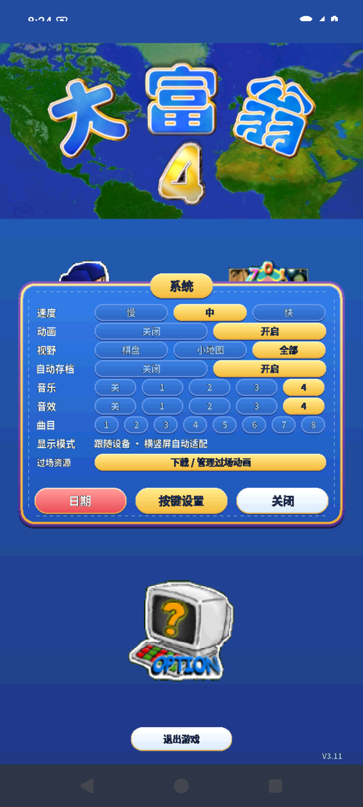
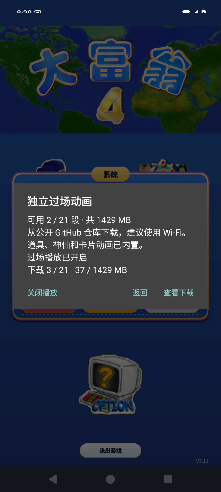

# 大富翁 4 · 联机重制版下载

本仓库用于公开分发 Windows 安装包、Android APK 和可选资源，不托管开发源码仓库及历史。

[打开游戏介绍与下载站](https://exp-games.github.io/rich4-online-release/)

## 下载与启动

当前版本为 [v0.1.8 联机预览版](https://github.com/EXP-Games/rich4-online-release/releases/tag/v0.1.8-preview.20261108)。Windows 和手机联机时必须一起更新到同一批版本。

本版修复关闭文本框的按键穿透、系统隐藏软键盘后无法重新唤起；连接中断后同进程重连可恢复此局草稿，房间聊天确认超时可手动重试。草稿只保存在内存，不自动重发，也不跨房间或新对局带入。保留此前棋盘浮层、触屏返回和联机修复。

另完成同机 Windows＋Android 模拟器两个客户端及两个 AI 的自然 30 天完整局：255 个共享模型／RNG 边界一致，双方持续在线至结算，正常回到原房、保留口令并重置准备。这个结果不替代真机、四台独立设备或异地整局验收。

| 文件 | 使用方法 |
| --- | --- |
| [Windows x64 完整 ZIP，约 1.68 GB](https://github.com/EXP-Games/rich4-online-release/releases/download/v0.1.8-preview.20261108/Rich4-Windows-x64-v0.1.8-preview.20261108.zip) | 全部解压，运行 `Rich4/Start.vbs`；不需要 Steam，不要单独移动 EXE |
| [Android ARM64 无过场 APK，约 294 MB](https://github.com/EXP-Games/rich4-online-release/releases/download/v0.1.8-preview.20261108/Rich4-Android-arm64-no-cinematics-v0.1.8-preview.20261108.apk) | Android 8.0 及以上；同签名可覆盖安装，首次启动需要准备资源 |
| [SHA256SUMS.txt](https://github.com/EXP-Games/rich4-online-release/releases/download/v0.1.8-preview.20261108/SHA256SUMS.txt) | 用 SHA-256 核对下载文件完整性 |

APK 省去 21 段独立过场视频，保留道具、神仙、卡片、角色和住院等游戏内动画，以及音乐、音效、语音。进入系统设置 → 过场资源，可选下载约 1.43 GB 的独立过场，支持取消、重试及开启／关闭播放。已完成的文件保留，更新 APK 时可继续复用。当前不发布完整过场 APK。Windows 包包含完整过场。

过场文件独立放在 [cinematics-v1 资源发布页](https://github.com/EXP-Games/rich4-online-release/releases/tag/cinematics-v1)，APK 按内置文件大小和 SHA-256 清单校验，每次升级无需重复下载。未完成的单个文件重试时会从头下载。

| 系统设置入口 | 可选下载与播放开关 |
| --- | --- |
|  |  |

Android 包使用开发签名，属于预览版。ARM64 手机实机及四台实体设备整局仍待验收，iOS 尚未提供。

## 联机教程

1. 主菜单点击 ONLINE，填写昵称、服务器 IP 和端口。房间口令为 6 位。
2. 玩家电脑可“本地建房”，平台管理员可通过 Linux 大厅创建房间；其他玩家填写地址和口令加入。Windows 本地建房需要 Python 3.10+，加入已有房间不需要 Python。
3. 加入序号最小者为房主，负责选择地图、期限和席位。三人一叉是三人局；三人一空会在开始时补入 AI。
4. 点击“准备”，选择断线预案，再点“确认并准备”。角色卡显示“已准备”后，由房主开始游戏。
5. 对局按角色轮流操作。左下角三行文字播报可点击进入聊天；点击其他位置收起。医院和监狱可点击“返回”。联机不提供存档。

地图统一为：中国台湾、中国大陆、日本、美国、宇宙、武侠、恐龙、南岛历险。联机只提供这八张经典地图，随机地图改进暂停。

平台房间全员离开后初始化并保留口令；玩家自建房间随房主离开解散。不要公开管理令牌、私人房间配置或日志。

## v0.1.8 更新

- 修复关闭文本框、旋转或失焦后按键抬起穿透游戏的问题。
- 系统隐藏软键盘后，点聊天区或房间输入框可重新唤起。
- 同进程断线重连恢复此局未发送草稿；换房、新局、离房清理，不写磁盘。
- 房间聊天确认超时后可手动重试，不自动重发；迟到的旧确认不会当作新消息。

Android API 35 x86_64 模拟器通过 55 秒后台离线、回房、原身份重连、恢复草稿及继续轮转；Windows 另完成键盘边界和延迟确认检查。ARM64 真机、厂商省电策略、四台实体设备及异地完整局仍待验收。
