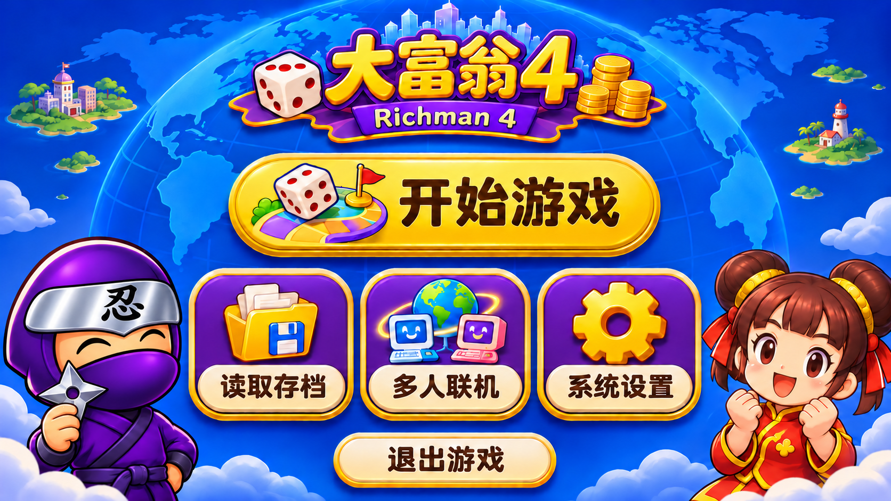
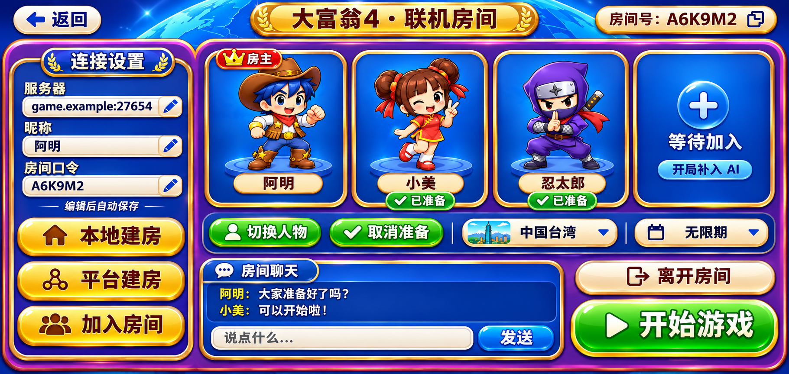
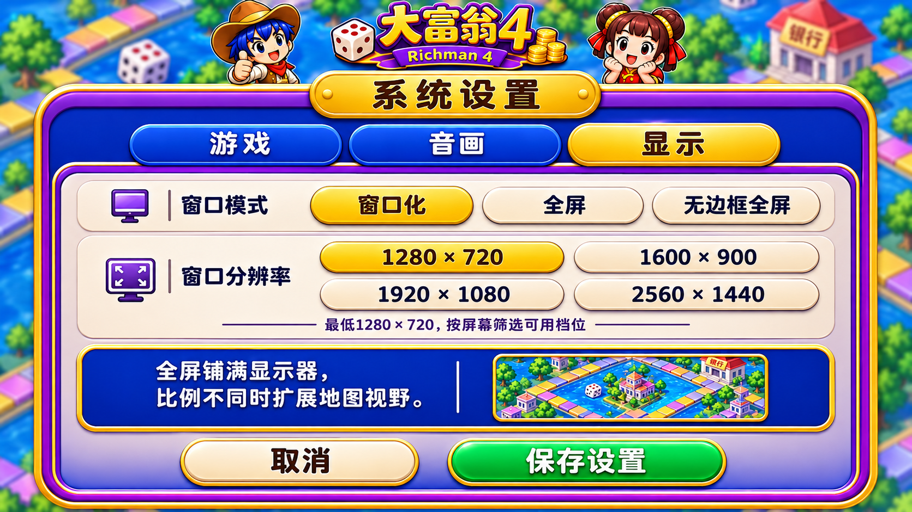
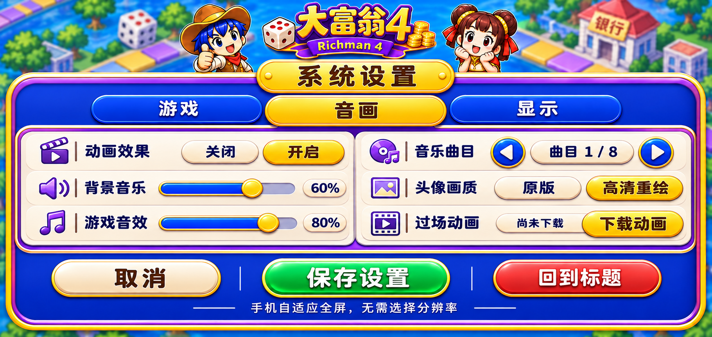
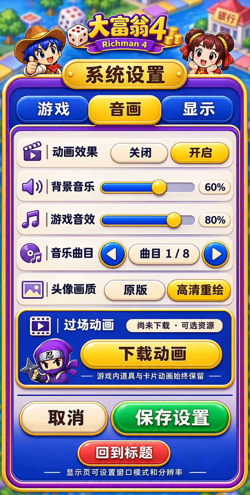
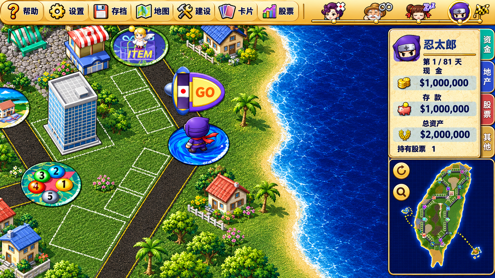
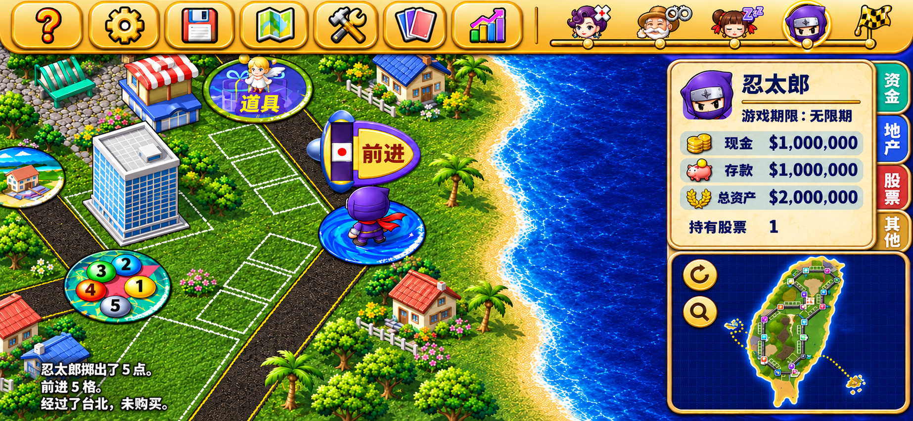
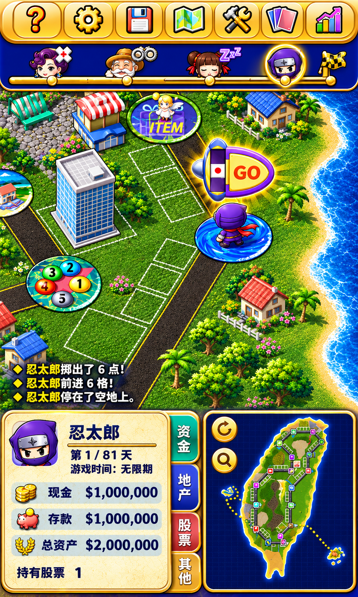

# 大富翁 4 · 联机重制版下载

本仓库用于公开分发 Windows 安装包、Android APK 和可选资源，不托管开发源码仓库及历史。

[打开游戏介绍与下载站](https://exp-games.github.io/rich4-online-release/)

下载区下方新增 [新版界面效果图](https://exp-games.github.io/rich4-online-release/#preview)：七组页面，每组提供 PC 横屏、手机横屏、手机竖屏，共二十一张，支持筛选和点击放大。网页采用蓝色、紫金边框与立体按钮的新视觉。效果图尚未全部实装，不代表当前安装包已经包含这些新界面；棋盘人物、神仙和 NPC 的造型仍需按原版校准。

## 下载与启动

当前版本为 [v0.1.9 联机预览版](https://github.com/EXP-Games/rich4-online-release/releases/tag/v0.1.9-preview.20261108)。Windows 和手机联机时必须一起更新到同一批版本。

本版加入棋盘触控浏览：单指拖动地图，按住查看物件，联机等待时也可本机查看。双指、系统取消、失焦、旋转和进入弹窗会清理旧手势，避免误点 GO。只改变本机视角，不移动角色或修改对局状态。保留此前聊天、浮层和触屏返回修复。

另完成同机 Windows＋Android 模拟器两个客户端及两个 AI 的自然 30 天完整局：255 个共享模型／RNG 边界一致，双方持续在线至结算，正常回到原房、保留口令并重置准备。这个结果不替代真机、四台独立设备或异地整局验收。

| 文件 | 使用方法 |
| --- | --- |
| [Windows x64 完整 ZIP，约 1.68 GB](https://github.com/EXP-Games/rich4-online-release/releases/download/v0.1.9-preview.20261108/Rich4-Windows-x64-v0.1.9-preview.20261108.zip) | 全部解压，运行 `Rich4/Start.vbs`；不需要 Steam，不要单独移动 EXE |
| [Android ARM64 无过场 APK，约 294 MB](https://github.com/EXP-Games/rich4-online-release/releases/download/v0.1.9-preview.20261108/Rich4-Android-arm64-no-cinematics-v0.1.9-preview.20261108.apk) | Android 8.0 及以上；同签名可覆盖安装，首次启动需要准备资源 |
| [SHA256SUMS.txt](https://github.com/EXP-Games/rich4-online-release/releases/download/v0.1.9-preview.20261108/SHA256SUMS.txt) | 用 SHA-256 核对下载文件完整性 |

APK 省去 21 段独立过场视频，保留道具、神仙、卡片、角色和住院等游戏内动画，以及音乐、音效、语音。进入系统设置 → 过场资源，可选下载约 1.43 GB 的独立过场，支持取消、重试及开启／关闭播放。已完成的文件保留，更新 APK 时可继续复用。当前不发布完整过场 APK。Windows 包包含完整过场。

过场文件独立放在 [cinematics-v1 资源发布页](https://github.com/EXP-Games/rich4-online-release/releases/tag/cinematics-v1)，APK 按内置文件大小和 SHA-256 清单校验，每次升级无需重复下载。未完成的单个文件重试时会从头下载。

Android 包使用开发签名，属于预览版。ARM64 手机实机及实体四机验收已移出当前范围，不代表已验证；公网完整对局验收仍未完成。iOS 尚未提供。

## 新版界面设计预览

以下是设计效果图，尚未全部实装；不表示当前 APK／Windows 包已经包含。点击图片可查看原图，完整图集见 [下载站效果图](https://exp-games.github.io/rich4-online-release/#preview)。

| 页面 | PC 横屏 | 手机横屏 | 手机竖屏 |
| --- | --- | --- | --- |
| 主菜单 |  |  |  |
| 联机房间 |  |  |  |
| 系统设置 |  |  |  |
| 离线行动确认 |  |  |  |
| 选择地图 |  |  |  |
| 选择角色 |  |  |  |
| 棋盘与行动条 |  |  |  |

菜单插画、立绘和头像保留已认可的设计风格；棋盘中的人物、神仙与 NPC 的造型仍需忠于原版校准。游戏时间默认无限期，单机使用原角色名。房间编辑结束自动保存、新 UI 接入和 PC 分辨率约束仍在开发，不作为当前安装包已完成功能宣传。

### 行动条与按钮状态

| 行动条局部及状态 | 按钮未按下／按下 |
| --- | --- |
|  |  |

## 联机教程

1. 主菜单点击 ONLINE，填写昵称和 6 位房间口令。服务器地址可在游戏内查看和修改；首次默认值由游戏配置提供，已保存的自定义设置优先。
2. 玩家电脑可“本地建房”，平台管理员可通过 Linux 大厅创建房间；其他玩家填写地址和口令加入。Windows 本地建房需要 Python 3.10+，加入已有房间不需要 Python。
3. 加入序号最小者为房主，负责选择地图、期限和席位。三人一叉是三人局；三人一空会在开始时补入 AI。
4. 点击“准备”，选择断线预案，再点“确认并准备”。角色卡显示“已准备”后，由房主开始游戏。
5. 对局按角色轮流操作。左下角三行文字播报可点击进入聊天；点击其他位置收起。医院和监狱可点击“返回”。联机不提供存档。

地图统一为：中国台湾、中国大陆、日本、美国、宇宙、武侠、恐龙、南岛历险。联机只提供这八张经典地图，随机地图改进暂停。

平台房间全员离开后初始化并保留口令；玩家自建房间随房主离开解散。不要公开管理令牌、私人房间配置或日志。

## v0.1.9 更新

- 棋盘支持单指拖动，八个地图朝向按实际渲染投影对齐。
- 轻微手抖保留点按，按住物件仍可查看说明。
- 联机等待时可查看本机地图，不获得其他玩家的操作权限。
- 双指、取消、失焦和旋转时清理旧手势，避免误点 GO 或工具栏。

Windows 横竖屏夹具与 Android API 35 x86_64 模拟器实际滑动通过；与 Windows 及两个 AI 继续四次人类掷骰，六个共享模型／RNG 边界一致。实体手机及实体四机验收已移出当前范围，公网完整对局仍待验收；移除范围不等于验证通过。不包含双指缩放。
